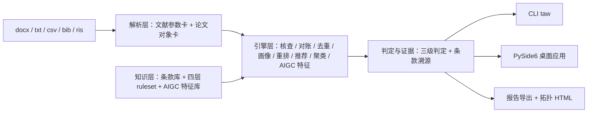

# 毕业论文全流程审计工作台（thesis-audit-workbench）

> 🚧 **开发中（M1 数据先行已就绪：双生成器 + 字节冻结 fixtures + 四层 ruleset 骨架）** — 计划、里程碑与进度见 [plan/00-README总览.md](plan/00-README总览.md)

覆盖毕业论文**开题（综述辅助）→ 写作（反向引用、术语一致性、图表编号）→ 完稿（幻觉画像、AIGC 自检、对账）→ 送审（学校格式、结构检查单、体检分、指纹存证）**全流程的确定性审计台。LLM 聊天给不了持久状态、可审计证据与全量批处理——本工具是 AI 时代的论文质量防线。

- **全本地离线运行，零上传**（联网仅 DOI 核验等三个显式开关扩展项）；
- **每条结论挂条款溯源**（编号 + 条号 + 原文摘录 + status），三级判定：通过 / 不符 / 待人工确认；
- **内置零 API 评测基准**，指标可复现、误报 0 优先。

## 两条审计线（16 模块）

**文献审计线**（GB/T 7714-2015/2025 双标尺）

| 模块 | 能力 |
|---|---|
| 噪声鲁棒解析 | txt/Word/CSV/BibTeX/RIS 输入；断行、连字符断裂、全半角混排等噪声分层报告 F1 |
| 格式核查与自动修正 | 必著录项/标点/页码卷期/著者阈值；机械项自动修正 diff 高亮、逐条接受/回退 |
| versioned ruleset | 国标双标尺 → 年份版 → 期刊 profile → 学校模板 profile 四层规则包 |
| 正文引用对账 | 幽灵文献、悬空引用、乱序断档、著者-年份不匹配全检出 |
| 重复条目检测合并 | DOI 精确 + 标题归一模糊 + 辅助证据；误合并率 0 |
| **AI 幻觉文献风险画像** | DOI 校验位、时间逻辑矛盾、"格式完美但字段组合不可能"统计特征 |
| 反向引用推荐与一键插入 | 库内 BM25 检索防幻觉闭环；一键插入触发顺序编码制全文编号重排 |
| 论证链拓扑 | 引用语境 → 论点支撑矩阵 → pyvis 拓扑 HTML（0 外链，结论点击联动） |
| 本地文献库 | SQLite 跨论文库、HalluRef-Bench 公开基准、Word 批注回写、文献表指纹、体检分 |

**全文审计线**（毕业论文热门需求 A–F）

| 模块 | 能力 |
|---|---|
| 图表/公式/交叉引用审计 | 悬空标记、幽灵对象、乱序断档检出 + 全文编号重排引擎 |
| 学校格式模板核查 | docx 样式树/节属性/页眉页脚核对；GB/T 7713.1 → 学校 profile 可自定义导入 |
| 术语与数字用法一致性 | 术语表（标准↔变体）+ GB/T 15835 全文扫描 + 变体分布热区 |
| AIGC 痕迹自检 | 本地启发式特征（逐条挂依据）；**风险提示≠判定，仅供自查** |
| 综述辅助 | 库内 TF-IDF 主题聚类 + 年代时间线 + 研究空白提示 |
| 结构检查单 | 摘要四要素/关键词数/章小结/结论呼应——挂条款的交互式检查单 |

## 架构



详见 [plan/03-架构与技术选型.md](plan/03-架构与技术选型.md)。

## 快速开始（开发态）

```bash
git clone <repo-url>
cd thesis-audit-workbench
python -m venv .venv
# Windows: .venv\Scripts\activate    POSIX: source .venv/bin/activate
python -m pip install -U pip
python -m pip install -e "./code[dev,docx]"

taw --version
taw selfcheck        # 环境自检：版本 / 数据目录 / 可选依赖
taw demo             # 打印 16 模块注册表（进度跟踪）

cd code
python -m pytest tests -v
```

> Windows 下 `py` 启动器会无视 venv，激活后一律用 `python -m ...`。

## 目录结构

```
plan/    计划文档与交接快照（00 总览 / 01 题目 / 02 需求 / 03 架构 / 04 详设 / 05 数据与里程碑）
data/    数据根：samples / frozen 字节冻结产物 / knowledge 条款库 / rulesets 规则包 / bench 评测集
code/    代码根：src/taw 包 + tests + tools（pyproject 在此）
docs/    技术报告等固化材料（规划中）
```

## 限制与免责声明

- 审计与提示结果**供参考**：格式以学校/期刊要求为准，文献真伪与学术诚信以原文及官方核查为准；
- AI 幻觉画像与 AIGC 自检均为**风险提示，不构成判定**，报告中强制声明；本工具不提供查重、降重、润色与改写功能；
- 条款库逐条挂出处与核对状态，未核对条目以"待核对"展示、不参与判定。

## License

[MIT](LICENSE)
