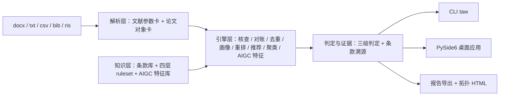

# 毕业论文全流程审计工作台（thesis-audit-workbench）

> 🚧 **开发中（M6 桌面交付已收口：PySide6 GUI + Word/WPS COM 实机验证 + PyInstaller onedir 双 exe）** — 计划、里程碑与进度见 [plan/00-README总览.md](plan/00-README总览.md)

覆盖毕业论文**开题（综述辅助）→ 写作（反向引用、术语一致性、图表编号）→ 完稿（幻觉画像、AIGC 自检、对账）→ 送审（学校格式、结构检查单、体检分、指纹存证）**全流程的确定性审计台。LLM 聊天给不了持久状态、可审计证据与全量批处理——本工具是 AI 时代的论文质量防线。

- **全本地离线运行，零上传**（联网仅 DOI 核验等三个显式开关扩展项）；
- **每条结论挂条款溯源**（编号 + 条号 + 原文摘录 + status），三级判定：通过 / 不符 / 待人工确认；
- **内置零 API 评测基准**，指标可复现、误报 0 优先。

## 两条审计线（16 模块）

**文献审计线**（GB/T 7714-2015/2025 双标尺）

| 模块 | 能力 |
|---|---|
| 噪声鲁棒解析 | txt/Word/CSV/BibTeX/RIS 输入；断行、连字符断裂、全半角混排等噪声分层报告 F1 |
| 格式核查与自动修正 | 必著录项/标点/页码卷期/著者阈值；机械项自动修正 diff 高亮、逐条接受/回退 |
| versioned ruleset | 国标双标尺 → 年份版 → 期刊 profile → 学校模板 profile 四层规则包 |
| 正文引用对账 | 幽灵文献、悬空引用、乱序断档、著者-年份不匹配全检出 |
| 重复条目检测合并 | DOI 精确 + 标题归一模糊 + 辅助证据；误合并率 0 |
| **AI 幻觉文献风险画像** | DOI 校验位、时间逻辑矛盾、"格式完美但字段组合不可能"统计特征 |
| 反向引用推荐与一键插入 | 库内 BM25 检索防幻觉闭环；一键插入触发顺序编码制全文编号重排 |
| 论证链拓扑 | 引用语境 → 论点支撑矩阵 → pyvis 拓扑 HTML（0 外链，结论点击联动） |
| 本地文献库 | SQLite 跨论文库、HalluRef-Bench 公开基准、Word 批注回写、文献表指纹、体检分 |

**全文审计线**（毕业论文热门需求 A–F）

| 模块 | 能力 |
|---|---|
| 图表/公式/交叉引用审计 | 悬空标记、幽灵对象、乱序断档检出 + 全文编号重排引擎 |
| 学校格式模板核查 | docx 样式树/节属性/页眉页脚核对；GB/T 7713.1 → 学校 profile 可自定义导入 |
| 术语与数字用法一致性 | 术语表（标准↔变体）+ GB/T 15835 全文扫描 + 变体分布热区 |
| AIGC 痕迹自检 | 本地启发式特征（逐条挂依据）；**风险提示≠判定，仅供自查** |
| 综述辅助 | 库内 TF-IDF 主题聚类 + 年代时间线 + 研究空白提示 |
| 结构检查单 | 摘要四要素/关键词数/章小结/结论呼应——挂条款的交互式检查单 |

## 架构



详见 [plan/03-架构与技术选型.md](plan/03-架构与技术选型.md)。

## 快速开始（开发态）

```bash
git clone https://github.com/yuluo554/thesis-audit-workbench.git
cd thesis-audit-workbench
python -m venv .venv
# Windows: .venv\Scripts\activate    POSIX: source .venv/bin/activate
python -m pip install -U pip
python -m pip install -e "./code[dev,docx,viz,gui]"   # 含 gui：收集数对账须到 362（缺 gui 则 GUI 模块整模块 skip，只剩 353）

taw --version
taw selfcheck        # 环境自检：版本 / 数据目录 / 可选依赖
taw demo             # 数据面 + 16 模块注册表（进度跟踪）
taw parse <文献表或论文>   # 解析文献表（txt/csv/bib/ris）或论文 docx；--json 出结构化卡

# 文献线全链审计（REF-02..09）+ 拓扑 HTML + 本地文献库入库
taw audit refs <文献表> --body <正文> --report report.json \
    --topology topo.html --library lib.db
taw audit bench --line refs   # 文献线 9 指标基准（零 API 依赖，可复现）

# 全文线全链审计（FULL-01..06：交叉引用/学校格式/术语数字/AIGC/综述/结构）
taw audit thesis <论文.docx> --report full.json          # 默认学校 profile=default
taw audit thesis <论文.docx> --profile school-demo       # 套用学校模板 profile
taw audit bench --line full    # 全文线 5 指标基准
taw audit bench --line all     # 两线 14 指标一次跑全

cd code
python -m pytest tests -q   # 收集 362 项（干净环境 356 通过/6 跳过；本机装 com extras 后 361/1）
```

> **收集数对账**：干净环境收集数必须 = **362**（`[gui]` 缺装会让 GUI 模块整模块 skip、
> 只剩 353——这正是"双绿但悄悄少跑"的形态，故快速开始装 `[dev,docx,viz,gui]`）。
> 跳过项随 extras 变（`[com]` 未装 → 5 项 Word/WPS 实机组 skip；无 Pillow → 演示 GIF 合成 1 项 skip），
> **收集数不变**。

## 桌面应用（PySide6 GUI，M6）

GUI **只消费引擎 API**（`taw.refaudit` / `taw.fullaudit` / 各模块函数），与 CLI 同一实现——不另起第二套判定逻辑（plan/03 §一）。

```bash
python -m pip install -e "./code[gui]"     # PySide6（py3.8 解析到 6.6.3.1）
taw gui                                    # 启动桌面窗口
taw gui --check                            # 离屏启动自检（CI/无显示器环境用，不进事件循环）
```

- 两个标签页：**文献审计线**（选文献表 + 正文 → 跑审计 → findings 表格三级判定 + 条款待核对标记 → 导出报告/拓扑/批注回写）与**全文审计线**（选 docx → 跑审计 → 导出报告/综述聚类）；
- findings 表格每行给「规则 / 状态（通过·不符·待人工确认）/ 类型 / 位置 / 条款标记 / 说明建议」，选中行看**完整证据链**（条款 + 依据 + 位置）；
- 条款 `pending` 的一律显示「**条款待核对**」，不冒充标准原文（NFR-04 落到界面）；
- 所有 HTML 产物（引用拓扑 / 综述聚类）同样过 **0 外链硬断言**。

## Word/WPS COM 联动（M6 实机验证）

```bash
python -m pip install -e "./code[com]"     # pywin32（仅 Windows）
```

- **外挂定位**：判定与产物生成的确定性通路是 `taw.docxutil` / `taw.reflib`（M3 已落地并有基准回归）；COM 层只做触发壳——打开、另存、读回；
- **实机验收断言**：`reflib.write_comments` 注入的 Word 批注，被**真实 Word/WPS 读回条数一致**（M6 实测：6 findings → Word `Comments.Count = 6`）；
- **WPS 兼容范围**：本机同时装 Word（16.0）与 WPS（KWPS.Application，12.1.0.28505），`inspect_document` 同一接口在两者上均可打开并计数；
- CI 无 Office → 实机组自动 skip（`win32 + pywin32 + 注册表有 Office ProgID` 三条件缺一即跳过）。

## 打包（PyInstaller onedir 双 exe，M6）

```bash
python -m pip install -e "./code[pkg]"     # py3.8 锁 pyinstaller>=5.13,<6
cd code
python -m PyInstaller tools/taw.spec --noconfirm --clean --distpath ../dist
python tools/check_build_redline.py ../dist/taw      # 构建红线
python tools/verify_neutral_dir.py ../dist           # 中立目录五连
```

- **双 exe 共用一个 onedir**：`dist/taw/taw.exe`（CLI，console=True）+ `dist/taw/taw-gui.exe`（GUI，console=False）；
- **内嵌数据**：`data/README.md`（数据根标志）+ `frozen/`、`bench/`、`knowledge/`、`rulesets/` 随包；`taw/paths.py` 五分支已覆盖 PyInstaller 5/6 两种布局；
- **构建红线**（`check_build_redline.py`）：dist 扫描无 `_private/`、无 `.db`/`.env`/`.key`、无真实实体关键词；内嵌数据与仓库 `data/` **逐文件对账**（缺文件/多文件/字节不符三类偏差全检出）；
- **中立目录干净验证五连**（`verify_neutral_dir.py`）：把 dist 复制到**仓库树外**并**剥离 PATH**，逐条取真实退出码跑 `selfcheck` / `demo` / `parse` / `audit refs` / `audit bench --line all`（不接管道，防真实状态被吞）。

## 内置评测基准（两线 14 指标，零 API 依赖）

一条命令跑全两线 14 指标并落盘（报告无时间戳、两次运行位级一致）：

```bash
taw audit bench --line all --report reports/bench_all.json   # 两线 14 指标一次跑全
# 分线：--line refs（文献 9）/ --line full（全文 5）；--json 出纯 JSON（辅助信息走 stderr）
```

- **环境**：全程离线（屏蔽 socket 亦全过，`test_bench_full.py` 断言）；数据面读 `data/frozen/` +
  `data/bench/`，不触网；Python 3.8 与 3.12 双解释器复跑一致；报告键序固定（`sort_keys`）、无时间戳。
- **复跑纪律**：任一里程碑收尾（含改历史等不动工作树的操作）后复跑三基线防回退——
  M2 解析 F1 + M3 文献线 9 指标 + M4 全文线 5 指标（见 [plan/HANDOFF-M6.md](plan/HANDOFF-M6.md) 命令速查）。
- **判定口径**：**误报 0 优先**——只判确定性可判项，证据不充分一律 `manual_confirm` 不硬判。

### 文献审计线 9 指标（`taw audit bench --line refs`，M5 固化）

| # | 指标 | 门槛 | 实测结果 |
|---|---|---|---|
| 1 | 分层解析 F1 | clean ≥0.99 / light ≥0.97 / heavy ≥0.95 | 1.0 / 1.0 / 0.9874 **全过** |
| 2 | 格式检出率 / **误报率** | **FP=0**（含 clean 条目） | P=1.0、**FP=0**、clean FP=0；R=0.6944 召回缺口 **55/55 全归因**到载体/噪声门控（详见下） |
| 3 | 修正准确率 | 修正闭合性 =1.0 | **79/79 = 1.0** |
| 4 | 对账准确率 | 悬空/幽灵/乱序/著者-年全中 | **1.0（4/4）** |
| 5 | 去重 P/R | **误合并率 0** | P=1.0 R=1.0，**误合并 0** |
| 6 | 幻觉画像检出率 | HalluRef 全检出 + genuine 误报 0 | **100/100**，genuine 误报 **0** |
| 7 | 双标尺差异检出率 | 全检出 | **2/2 = 1.0** |
| 8 | 推荐 Recall@5 / MRR | 库内防幻觉闭环 | Recall@5 **0.7778** / MRR **0.7222** |
| 9 | 编号重排一致性 | 插入/删除矩阵 100% | **79/79 = 100%** |

> 指标 2 的召回缺口不是缺陷：55 处未命中**逐处**归因到 plan/04 §十 10.2 的既定判定纪律——
> 噪声门控 18（带断行/连字符/空格修复 flag 的缺项不判）、ris 载体豁免 9（ris 不渲染"等/others"）、
> 文件级编码制混用 12、三著者带"等"歧义 6、DOI/year 被噪声污染不可观察 6、载体签名不唯一 2、
> 载体语义 2。**UNKNOWN=0**，由 `test_bench_full.py` 钉死；任何新未归因 FN 即视为回归。

### 全文审计线 5 指标（`taw audit bench --line full`，M5 固化）

| # | 指标 | 门槛 | 实测结果 |
|---|---|---|---|
| 1 | 悬空/幽灵标记检出率 | 全检出 + 重排 100% | 悬空 **2/2**、幽灵 **2/2**；对象编号重排 **100%** |
| 2 | 样式核查检出 / **误报率** | 植入全检出 + **FP=0** | TP=**3/3**、**FP=0** |
| 3 | 术语一致性检出率 | 植入全检出 | TP=**4/4**、FN=0（含千分位与伪空格变体） |
| 4 | AIGC 植入检出率 | 植入全检出 + **FP=0** | TP=**3/3**、**FP=0**（伦理守卫断言通过） |
| 5 | 综述聚类与预分组对账 | 簇纯度 1.0 + 空白命中 | 簇纯度 **1.0**、研究空白命中一致 |

> Windows 下 `py` 启动器会无视 venv，激活后一律用 `python -m ...`。

## 目录结构

```
plan/    计划文档与交接快照（00 总览 / 01 题目 / 02 需求 / 03 架构 / 04 详设 / 05 数据与里程碑）
data/    数据根：samples / frozen 字节冻结产物 / knowledge 条款库 / rulesets 规则包 / bench 评测集
code/    代码根：src/taw 包 + tests + tools（pyproject 在此；tools 含打包 spec 与构建红线/中立验证脚本）
docs/    技术报告等固化材料（规划中）
```

数据面：`frozen/refs`（合成文献表 72 条 × 4 格式）、`frozen/thesis`（合成论文 docx + 真值）、
`frozen/audit`（正文引用对账夹具）、`frozen/review`（综述辅助语料 20 条 × 4 主题簇）、
`bench/halluref`（HalluRef-Bench v1 全量 200 条）；全部固定 seed/声明式、位级一致守门。

## 限制与免责声明

- 审计与提示结果**供参考**：格式以学校/期刊要求为准，文献真伪与学术诚信以原文及官方核查为准；
- AI 幻觉画像与 AIGC 自检均为**风险提示，不构成判定**，报告中强制声明；本工具不提供查重、降重、润色与改写功能；
- 条款库逐条挂出处与核对状态，未核对条目以"待核对"展示、不参与判定。

## License

[MIT](LICENSE)
